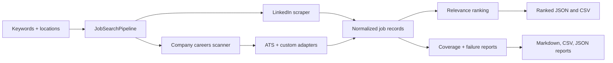

```text
__________       .__        __________             .___
\______   \ ____ |  |   ____\______   \_____     __| _/____ _______
 |       _//  _ \|  | _/ __ \|       _/\__  \   / __ |\__  \\_  __ \
 |    |   (  <_> )  |_\  ___/|    |   \ / __ \_/ /_/ | / __ \|  | \/
 |____|_  /\____/|____/\___  >____|_  /(____  /\____ |(____  /__|
        \/                 \/       \/      \/      \/     \/
```

# RoleRadar

Target-company job discovery with source coverage.

RoleRadar scans LinkedIn and company career systems such as Greenhouse, Ashby, Workday, Lever, Amazon Jobs, Google Careers, Meta Careers, Atlassian, Uber, Shopify, and other custom career pages. It normalizes postings, ranks relevant roles, and writes transparent coverage reports so you can see matches, gaps, and failed sources.

Most job-search workflows depend on LinkedIn alone or hide source failures. RoleRadar is built for targeted searches: define companies, run scans, review ranked jobs, and inspect source coverage without guessing what was missed.

## What It Does

- Scans LinkedIn and direct company career pages from one CLI pipeline.
- Uses a YAML company registry instead of hardcoded one-off scripts.
- Supports reusable adapters for common ATS and custom career systems.
- Normalizes jobs into a consistent shape for downstream review.
- Ranks roles with a deterministic relevance layer.
- Exports ranked jobs, coverage reports, and failure reports as JSON, CSV, and Markdown.
- Optionally generates CVs and cover letters from selected job data.

RoleRadar is role-agnostic at the scanner level. The current default relevance scoring is tuned for senior technical roles, but search terms and relevance rules can be adapted for product, design, data, operations, or other functions.

## Quick Start

```bash
git clone git@github.com:swanidhi/role-radar.git
cd role-radar
python -m venv .venv
source .venv/bin/activate  # Windows: .venv\Scripts\activate
pip install -r requirements.txt
playwright install
cp .env.example .env
```

Edit `.env` with the credentials you need:

```env
# LinkedIn credentials
LINKEDIN_USERNAME=your_linkedin_email@example.com
LINKEDIN_PASSWORD=your_linkedin_password

# Required only for CV / cover-letter generation
GOOGLE_API_KEY=your_google_api_key_here
GPT_4O_API=your_openai_key_here
GPT_4_1_API=your_openai_key_here
```

Run a direct company-careers scan:

```bash
python main.py search "Staff Software Engineer" \
  --locations "Remote" "United States" \
  --scrapers company_careers \
  --max-jobs 5
```

Run a combined LinkedIn and company-careers scan:

```bash
python main.py search "Staff Software Engineer" \
  --locations "Remote" "United States" \
  --scrapers linkedin company_careers \
  --max-jobs 5
```

Generated artifacts are written under `jobs/` or `output/` depending on the command path. Runtime output directories are intentionally ignored by git.

## How It Works



The important design choice is coverage transparency. A company can return matches, return jobs that do not match the current search, require manual review, fail technically, or be unsupported. RoleRadar records those states explicitly instead of silently dropping companies from the result set.

## Supported Sources

RoleRadar currently includes adapters for:

- LinkedIn through Playwright
- Greenhouse
- Lever
- Ashby
- Workday
- Amazon Jobs
- Google Careers
- Meta Careers
- Atlassian Careers
- Uber Careers
- Shopify Careers
- IBM-backed career search

The default registry in `config/target_companies.yaml` includes companies such as Airbnb, Stripe, Databricks, Cloudflare, Datadog, MongoDB, Coinbase, Elastic, GitLab, Twilio, Zscaler, Anthropic, OpenAI, Amazon, Adobe, CrowdStrike, Nvidia, PayPal, Atlassian, Uber, Snowflake, Salesforce, HashiCorp, Confluent, Shopify, Google, and Meta.

## Project Layout

```text
config/target_companies.yaml              # Company registry for direct career-site scans
src/scraper/company_careers/              # Company-careers scanner package
src/scraper/company_careers/adapters/     # ATS and custom source adapters
src/scraper/search/linkedin_scraper/      # Playwright LinkedIn scraper
src/utils/job_search_pipeline.py          # Shared orchestration for CLI/API flows
tests/test_company_careers.py             # Focused tests for adapters, coverage, ranking
docs/                                     # Architecture and usage docs
output/                                   # Generated artifacts, ignored by git
```

## Configuration

The company-careers scanner reads from `config/target_companies.yaml`.

Each target declares a company name, platform, and platform-specific fields:

```yaml
target_companies:
  - name: OpenAI
    platform: ashby
    slug: openai

  - name: Adobe
    platform: workday
    tenant: adobe
    wd_subdomain: wd5
    site_id: external_experienced

  - name: Google
    platform: google
    max_pages: 3
    search_terms:
      - Principal Engineer
      - Staff Software Engineer
```

See [Configuration](docs/CONFIGURATION.md) for the supported fields and examples.

## Outputs

A company-careers run can write:

- `job_postings_*.json`: normalized matched jobs
- `company_careers_ranked_*.json`: ranked jobs with relevance scores and reasons
- `company_careers_ranked_*.csv`: spreadsheet-friendly ranked review
- `company_careers_coverage_*.md`: readable source coverage summary
- `company_careers_coverage_*.csv`: source coverage table
- `company_careers_coverage_*.json`: structured coverage state
- `company_careers_failures_*.json`: technical/manual failures for follow-up

See [Outputs](docs/OUTPUTS.md) for the schema and how to interpret each artifact.

## Example Review Snapshot

A ranked CSV gives reviewers a compact view of the best roles:

| company | title | location | relevance_score | relevance_band |
| --- | --- | --- | ---: | --- |
| ExampleCo | Staff Software Engineer, Platform | Remote | 84 | high |
| Acme Cloud | Principal Software Engineer | United States | 82 | high |
| DataWorks | Senior Staff Machine Learning Engineer | Remote | 78 | good |

A coverage report shows source health separately from role matching:

| company | status | fetched_count | matched_count | follow-up |
| --- | --- | ---: | ---: | --- |
| ExampleCo | fetched | 42 | 3 | none |
| Acme Cloud | fetched_no_matching_roles | 18 | 0 | tune search/relevance or check later |
| LegacyCorp | manual_review_required | 0 | 0 | add adapter or review manually |

These are representative shapes. Actual output depends on configured companies, search terms, locations, and source availability.

## Documentation

- [Architecture](docs/ARCHITECTURE.md): pipeline flow, adapter model, and data model
- [Configuration](docs/CONFIGURATION.md): adding companies and tuning source behavior
- [Outputs](docs/OUTPUTS.md): generated files and coverage states
- [Relevance](docs/RELEVANCE.md): ranking behavior and how to adapt it beyond technical roles
- [Attribution](docs/ATTRIBUTION.md): upstream credit and what changed
- [Publishing Notes](docs/PUBLISHING.md): public-name, description, and topic guidance
- [LinkedIn Scraper Guide](docs/LINKEDIN_SCRAPER.md): LinkedIn-specific usage
- [API Reference](docs/API.md): FastAPI endpoints
- [Testing Guide](docs/TESTING.md): verification commands

## Common Commands

```bash
# LinkedIn-only search
python main.py search "Data Scientist" --locations "Remote" --scrapers linkedin --max-jobs 5

# Company-careers-only search
python main.py search "Staff Software Engineer" --locations "Remote" "United States" --scrapers company_careers --max-jobs 5

# Combined search
python main.py search "Staff Software Engineer" --locations "Remote" "United States" --scrapers linkedin company_careers --max-jobs 5

# Process existing jobs and generate a CV
python main.py process jobs/job_search_YYYYMMDD_HHMMSS.json --generate-cv

# Start the API server
python main_api.py
```

## Limits And Caveats

- Career-site APIs and HTML structures change; adapters need maintenance.
- LinkedIn can rate limit or require manual authentication checks.
- Some company sources may need manual review when no stable endpoint exists.
- Default relevance scoring currently favors senior technical roles.
- Users are responsible for complying with site terms, rate limits, and applicable law.

## Attribution

RoleRadar started from the open-source [JobSearch-Agent](https://github.com/sreekar2858/JobSearch-Agent) project by `sreekar2858`. This version extends that base with a config-driven company-careers scanner, ATS/custom adapters, relevance ranking, coverage reporting, and a more transparent review workflow.

See [Attribution](docs/ATTRIBUTION.md) for details.
