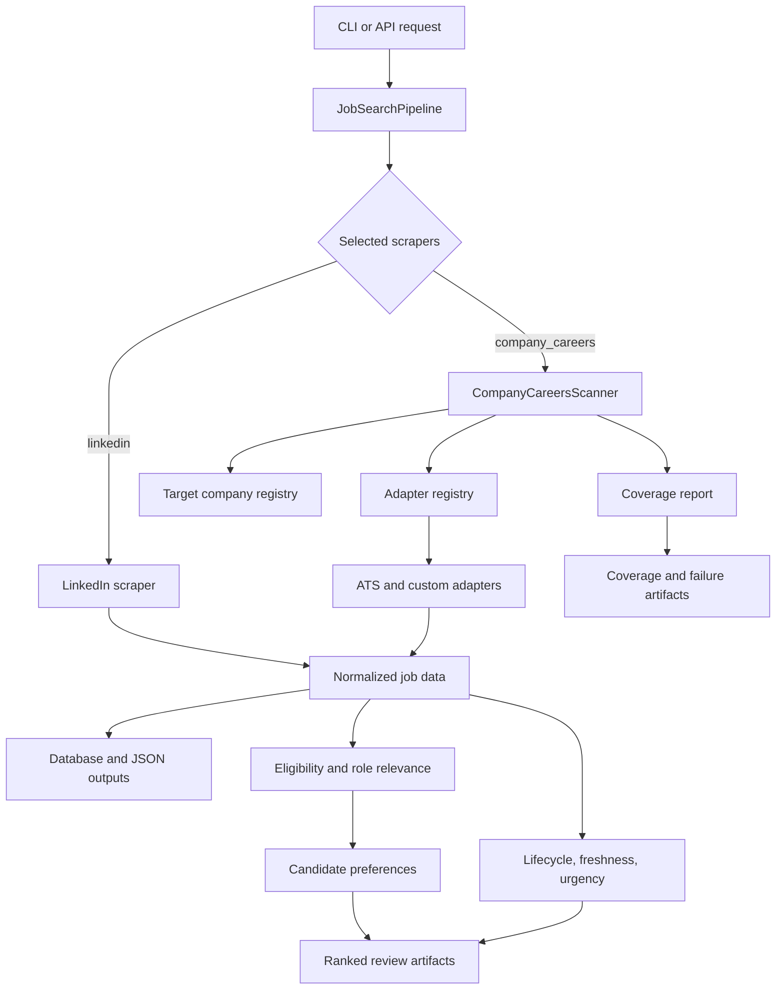

# Architecture

Source enumeration, terminal evidence, registry activation, and lifecycle
absence invariants are documented in [SOURCE_INTEGRITY.md](SOURCE_INTEGRITY.md).

RoleRadar has one orchestration layer and two primary acquisition paths:

- LinkedIn scraping through the existing Playwright scraper
- direct company-careers scanning through reusable ATS and custom adapters

The important product idea is not just fetching jobs. It is fetching jobs while preserving source coverage: what matched, what returned no relevant roles, what failed, and what needs manual follow-up.

## Flow

## Main Modules

`main.py`

CLI entry point. The `search` command accepts `--scrapers linkedin company_careers` so users can choose LinkedIn, direct company-careers scanning, or both.

`src/utils/job_search_pipeline.py`

Shared orchestration layer used by CLI/API flows. It invokes selected scrapers, normalizes results, writes output files, and handles database writes where enabled.

`src/scraper/search/linkedin_scraper/`

Playwright-based LinkedIn scraper inherited from the upstream project and adapted for the current workflow.

`src/scraper/company_careers/`

Direct company-careers scanner package. It loads target companies from YAML, calls the right adapter, filters/ranks relevant jobs, and emits coverage state.

`src/scraper/company_careers/freshness.py`

Config-backed deterministic lifecycle reconciliation. It reuses stable source identity, loads/persists history through the existing Supabase `tracked_jobs` store, advances missing evidence only for successful uncapped scans, parses bounded source dates, and supplies freshness/urgency annotations without changing ranking.

`src/scraper/company_careers/adapters/`

Source-specific adapters. Each adapter converts one source shape into normalized `JobRecord` objects.

`config/target_companies.yaml`

Company registry. This is where users add/remove targets and define platform-specific source metadata.

## Adapter Contract

Adapters should return a list of normalized `JobRecord` objects with:

- `job_id`
- `title`
- `company`
- `location`
- `url`
- `updated_at`
- `source`
- optional `departments`, `offices`, and `description`

Adapters should raise `AdapterError` for parse or endpoint failures that should be recorded as source failures.

## Coverage States

The company-careers scanner records a status for every configured target:

- `fetched`: source returned at least one matching job
- `fetched_no_matching_roles`: source was reachable, but no jobs matched current search/relevance criteria
- `manual_review_required`: source needs manual follow-up or a future adapter
- `not_implemented`: configured platform has no adapter
- `failed_technical`: source or parser failed technically

This is the main difference between RoleRadar and a simple scraper. Missing results are not all treated the same way.

## Extension Points

Add a new company on an existing platform:

1. Edit `config/target_companies.yaml`.
2. Add the company name and platform-specific fields.
3. Run a company-careers scan.

Add a new source type:

1. Create an adapter under `src/scraper/company_careers/adapters/`.
2. Register it in `src/scraper/company_careers/scanner.py`.
3. Add tests in `tests/test_company_careers.py`.
4. Add one or more companies using that platform in `config/target_companies.yaml`.

Adjust ranking:

1. Edit `src/scraper/company_careers/relevance.py`.
2. Add tests for expected ranking and exclusion behavior.
3. Rerun `tests/test_company_careers.py`.
