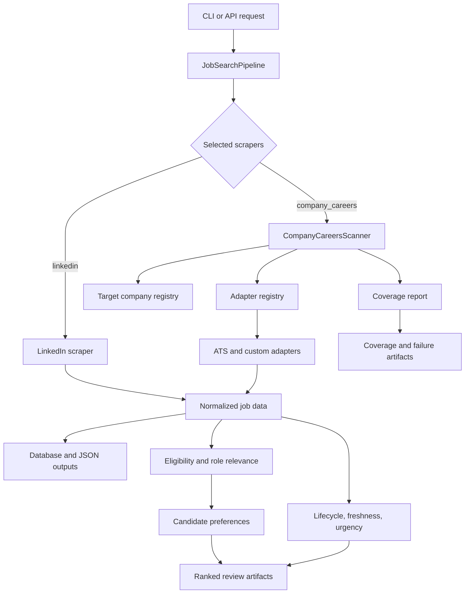

# Architecture

## Phase 6 incremental optimization

Incremental crawling is an optimization over the authoritative full-crawl
path, never a separate source of lifecycle truth. Typed run-mode, authority,
checkpoint, positive-only persistence, and forced-full rules are documented in
[PHASE6_INCREMENTAL_OPTIMIZATION.md](PHASE6_INCREMENTAL_OPTIMIZATION.md).

Source enumeration, terminal evidence, registry activation, and lifecycle
absence invariants are documented in [SOURCE_INTEGRITY.md](SOURCE_INTEGRITY.md).

RoleRadar has one orchestration layer and two primary acquisition paths:

- LinkedIn scraping through the existing Playwright scraper
- direct company-careers scanning through reusable ATS and custom adapters

The important product idea is not just fetching jobs. It is fetching jobs while preserving source coverage: what matched, what returned no relevant roles, what failed, and what needs manual follow-up.

## Flow



## Main Modules

`main.py`

CLI entry point. The `search` command accepts `--scrapers linkedin company_careers` so users can choose LinkedIn, direct company-careers scanning, or both.

`src/utils/job_search_pipeline.py`

Shared orchestration layer used by CLI/API flows. It invokes selected scrapers, normalizes results, writes output files, and handles database writes where enabled.

`src/scraper/search/linkedin_scraper/`

Playwright-based LinkedIn scraper inherited from the upstream project and adapted for the current workflow.

`src/scraper/company_careers/`

Direct company-careers scanner package. It loads target companies from YAML, calls the right adapter, filters/ranks relevant jobs, and emits coverage state.

`src/scraper/company_careers/freshness.py`

Config-backed deterministic lifecycle reconciliation. It reuses stable source identity, loads/persists history through the existing Supabase `tracked_jobs` store, advances missing evidence only for successful uncapped scans, parses bounded source dates, and supplies freshness/urgency annotations without changing ranking.

`src/scraper/company_careers/adapters/`

Source-specific adapters. Each adapter converts one source shape into normalized
`JobRecord` objects and reports the observations made while enumerating it.

`config/target_companies.yaml`

Company registry. This is where users add/remove targets and define platform-specific source metadata.

## Adapter Contract

The explicit company-careers flow is:

```text
provider adapter
    -> AdapterResult
       |-- jobs
       |-- inventory_items
       |-- scan observations
       |-- item_failures
       `-- capabilities_used (descriptive only)
    -> finalize_source_scan
    -> CompanyScanResult
    -> lifecycle / staged persistence
```

`AdapterResult.jobs` contains normalized `JobRecord` objects with:

- `job_id`
- `title`
- `company`
- `location`
- `url`
- `updated_at`
- `source`
- optional `departments`, `offices`, and `description`

`AdapterResult.scan` contains `SourceScanMetadata`: request/page counters,
terminal observations, safety-limit state, source-identity evidence, mutation and
pagination evidence, and adapter diagnostics. These are observations, not a
claim of trust. `finalize_source_scan` remains the only component that decides
whether the evidence is complete, healthy, identity-valid, and authoritative
for absence.

`inventory_items` contains stable provider IDs and their source namespace.
`item_failures` distinguishes hydration/normalization stage, retryability, and
`unreadable` versus `rejected` outcomes. Capabilities remain descriptive only:
they cannot create terminal evidence, validate identity, make a scan
authoritative, or bypass central finalization.

Adapters should raise `AdapterError` for parse or endpoint failures that should
be recorded as source failures. Migrated adapters attach their current scan
observations to the same exception instance; exception classes and failure
policy are unchanged.

### Compatibility and diagnostics

Every production dispatcher boundary returns `AdapterResult`. The scanner still
accepts both:

- a legacy `list[JobRecord]`, whose metadata is read from the historical
  `job_radar_scan_metadata` session attribute; and
- an explicit `AdapterResult`, whose `scan` value is used directly while any
  session alias is ignored and cleared.

Raw-list support is retained only as a compatibility path for direct/custom
callers and deterministic injected-adapter tests; no production registry entry
uses it. Existing adapter bodies may still publish the generic diagnostic
session alias, but the exported boundary snapshots it into `AdapterResult`.
Named provider pagination aliases are retained for tests and debugging. Neither
alias class is authoritative after an explicit result is returned, and the
scanner never uses a named provider alias for finalization.

The scanner clears metadata before every invocation and after every explicit
success or failure. Consequently an explicit result cannot inherit evidence
from a prior source, even when a test or caller reuses one session.

Only a centrally finalized `CompanyScanResult` with healthy or explicitly
hydration-degraded source state,
validated identity, provider-native terminal evidence, active source state, and
`scan_complete=True` can be authoritative for absence. Request, page, and job
budgets remain safety limits and never terminal evidence. Incomplete and failed
scans retain zero absence authority, so missing-job, possibly-missing, closure,
reopening, and staged Supabase reconciliation behavior is unchanged.

### Inventory authority modes

This is a source-coverage maintenance capability, not a new architecture phase.
Each source has an `inventory_authority`:

- `authoritative` (the backward-compatible default) may contribute positives
  and may reconcile scope-local absence only when every existing identity,
  terminal, mutation, safety, health, and result-authority check passes.
- `discovery_only` is trusted for positive observations but never for negative
  inference. Valid normalized jobs are persisted and refresh `last_seen`; an
  unseen job is never retired, deactivated, or marked missing from that result.

Discovery-only does not mean untrusted. Employer/source identity, stable IDs,
canonical and apply URLs, parsing, and exact source ownership remain subject to
the same validation. It means only that exhaustion is not proven. Typical
examples are a moving Oracle offset inventory, Eightfold pagination mutation, a
static page without terminal evidence, or a browser result page without an
exhaustion contract. Provider caps, request budgets, partial pagination, and
collection mutation can therefore yield useful positive-only results without
becoming absence evidence.

`can_reconcile_absence` is the single final lifecycle gate. It requires
`inventory_authority=authoritative` in addition to the pre-existing finalized
completeness, active-source, identity, health, mutation, pagination, and Phase 6
result-authority checks. Discovery-only finalization preserves terminal
diagnostics but records `scan_complete=false`, `inventory_complete=false`,
`result_authority=positive_only`, and no authoritative completion watermark.
Expected bounded partial discovery with usable positives reports
`healthy_discovery_only`; HTTP, parser, identity, schema, malformed-record, URL,
and contract failures remain real failures. This permits the useful positive
collection mechanics used by jobseek/freehire without importing unsafe absence
assumptions.

`source_health_code` is the effective finalized health used by cooldown policy.
The adapter's raw bounded-stop diagnostic remains in `stop_reason` (for example,
`canary_budget_reached` or `repeated_page`) and does not imply completeness.

### Final Phase 2 migration status

All 43 canonical dispatcher boundaries now return explicit results. The first
batch covers
Greenhouse, Lever, Ashby, Workday, SmartRecruiters, Eightfold, Dayforce, SAP
SuccessFactors, Teamtailor, BambooHR, Jobvite, Oracle Recruiting, iCIMS/Jibe/
Radancy, static HTML, public JSON, JavaScript embedded data, browser-rendered
HTML, first-party JSON, source XML, and Phenom. The second batch covers Apple,
Avature, Exalead, ClearCompany, Cornerstone CSOD, Deel, BeeSite, StartDate,
TalentBrew, HawkSearch v2, HiBob, UKG Pro, Paycor, PeopleSoft, Amazon, Shopify,
Google, Atlassian, Uber, and IBM Search. The final batch covers ADP, Meta, and
M-Cloud CWS without changing their provider protocols. The registry contains
50 keys because `custom:amazon`, `custom:atlassian`, `custom:google`,
`custom:ibm_search`, `custom:meta`, `custom:shopify`, and `custom:uber` are
aliases of canonical boundaries rather than additional adapters.

The authoritative channel for every migrated boundary is
`AdapterResult.scan`. The boundary bridge still snapshots the generic
`job_radar_scan_metadata` alias inside decorator-migrated adapters, and some
providers retain named pagination aliases for deterministic diagnostics. These
aliases are temporary compatibility surfaces; the scanner ignores them after
receiving an explicit result.

`fetch_with_mutation_restart` returns an explicit `AdapterResult`. It still
reads the generic session alias between the first and optional replacement
traversals for Avature, Atlassian, Eightfold, first-party JSON, iCIMS, Oracle
Recruiting, public JSON, Dayforce, SAP SuccessFactors, SmartRecruiters, and Uber. This is
a restart-internal compatibility detail: replacing it would require changing
the internal traversal callbacks, while retaining it preserves exactly one
restart, discards first-traversal jobs, and keeps all existing mutation
diagnostics. Its caller and the scanner receive explicit observations.

## Phase 3 inventory and hydration

```text
provider inventory enumeration
        -> authoritative inventory observations
        -> optional / required bounded hydration
           |-- hydrated normalized jobs
           `-- unreadable or rejected item outcomes
        -> AdapterResult
        -> finalize_source_scan
        -> lifecycle reconciliation and staged Supabase sync
```

Inventory existence is not hydration success. `finalize_source_scan` compares
authoritative totals and terminal evidence with `inventory_items_collected`,
while `jobs_collected` remains the normalized output count. A complete inventory
may therefore be authoritative with `source_health_code=hydration_degraded`.
Incomplete inventory always has zero absence authority.

For authoritative results, stable inventory IDs are converted to the same
namespaced source keys used by persisted jobs. Those keys protect prior records
from missing/closure transitions in both in-memory lifecycle reconciliation and
the staged Supabase transaction. Unreadable is never interpreted as gone, and
an unreadable item is not emitted as a successfully hydrated job. If no prior
record exists, protection does not invent one.

SmartRecruiters, BambooHR, Ashby, Greenhouse, Deel, Paycor, and PeopleSoft are
explicit split migrations. Deel, Paycor, and PeopleSoft use listing identity
only to protect an existing row when required detail transport is unreadable;
they never create a listing-only placeholder and still require detail/apply
evidence for creation or update. Lever, SmartRecruiters listing enumeration,
Cornerstone CSOD after bootstrap identity, and ADP MyJobs expose valid earlier
pages through an explicit incomplete result only when a later transport request
fails. Identity, HTTP/schema, duplicate, changed-total, pagination, and terminal
contradictions still fail closed.

Incomplete inventory discoveries can be inserted or refreshed by staged sync,
but their company is omitted from absence reconciliation. This means a partial
source can make positive progress without incrementing missing counters for any
unseen row. A cooldown skip follows the same no-authority rule and is not a
freshness observation.

## Phase 4 Workday protocol hardening

Workday CXS reachability and Workday employer identity are separate evidence.
An authoritative Workday scan requires a `workday_identity` registry block
whose official first-party HTTPS recruiting URL is bound to the exact expected
employer name, source scope, tenant, site, hostname, and allowed apply host. The
block also records the retained evidence source, the binding type (direct link,
redirect, embedded configuration, or retained first-party artifact), and the
exact Workday board URL exposed by that evidence. CXS job titles, descriptions,
tenant-name similarity, sibling catalogs, and Workday bootstrap metadata are not
employer proof. The identity decision is made once for the resolved site in a
scan and the complete block participates in the source/config cooldown
fingerprint.

An unfiltered Workday total below 2,000 follows the ordinary bounded listing
path. A total at or above 2,000 is never accepted directly: the adapter chooses
only facet parameters and opaque values advertised by the CXS response,
requires their counts to cover the parent query, and recursively forms
conjunctive partitions. Every authoritative leaf has a reported total below
2,000, exact applied-facet echoes, stable totals, and complete pagination.

Leaf jobs are unioned by the path-corroborated Workday requisition identity.
Identical overlap is counted and deduplicated; conflicting duplicates fail
closed. Completeness additionally requires every required leaf, a stable root
recheck, and a unique union count exactly equal to the root total. The adapter
returns discovered `InventoryItem`s on an incomplete partition traversal, but
central finalization grants no global absence authority.

The Workday hard bounds are depth 3, 128 partition states, 10,000 unique jobs,
and a configurable source-wide request budget defaulting to 500 (hard maximum
2,000). Identity/discovery, root/facet, partition listing, root validation, and
replacement-traversal requests share that budget. Repeated partition state,
unsplittable cap-bound leaves, contradictory totals, and every exhausted bound
are non-terminal. Observable partition mutation permits exactly one whole-tree
restart; first-traversal jobs are discarded and never unioned with the second.

See [PHASE4_WORKDAY_PROTOCOL_REVIEW.md](PHASE4_WORKDAY_PROTOCOL_REVIEW.md) for
the production audit, deterministic fixtures, and opt-in canary status.

## Phase 4 Dayforce and SAP SuccessFactors protocol hardening

Dayforce supports one repository-evidenced contract:
`nextjs_jobposting_search`. It requires the exact locale/tenant/board Candidate
Portal shell, one unambiguous `__NEXT_DATA__` site-info record, an anonymous
NextAuth CSRF token from the same session, and the fixed tenant search POST.
The shell proves protocol routing only. Employer ownership requires a reviewed
`dayforce_identity` block binding a first-party official recruiting URL to the
exact tenant and board. All current production Dayforce entries remain useful
for positive discovery but identity-unproven for absence decisions.

Dayforce pagination accounts separately for raw postings, duplicate
requisitions, rejected records, unreadable details, and normalized jobs. A raw
provider total may therefore exceed unique lifecycle inventory. Explicit
`terminal_accounted_items` records the raw reconciliation without changing the
stable requisition inventory. A transient detail failure protects the listed
requisition as unreadable and emits no placeholder. A later transient search
failure can return incomplete partial progress only after employer identity and
earlier pages are valid. Total mutation gets one whole-traversal restart;
pagination loops and malformed contracts do not.

SuccessFactors supports the three repository-evidenced RMK variants:
`rmk_table`, `rmk_tile`, and `rmk_columnized`. HTML variants bind table values
through unique header IDs (not column position) and reject duplicate headers,
unknown/duplicate cell attribution, malformed row lengths, and missing stable
title/apply identity. Columnized RMK requires the reviewed surface identity
marker, standard client markers, one CSRF token, named JSON fields, canonical
detail identity, and job-specific apply evidence. A transient columnized detail
failure is an unreadable listed requisition; deterministic detail identity or
apply contradictions remain source failures.

Both providers share a configurable source-wide `protocol_request_budget`
(default 2,500, hard maximum 5,000). Bootstrap/identity, CSRF, listing, detail,
and retry requests share it across the optional mutation restart. The budget is
operational and excluded from the cooldown fingerprint; tenant/board, host,
locale, variant, official identity evidence, and SuccessFactors identity marker
are fingerprinted. Budget exhaustion, identity/CSRF/schema failures, pagination
contradictions, unsupported variants, and mutation exhaustion are non-transient
for cooldown purposes. Only timeouts, connections, 429, and selected 5xx
responses advance a cooldown streak.

See [PHASE4_DAYFORCE_SUCCESSFACTORS_REVIEW.md](PHASE4_DAYFORCE_SUCCESSFACTORS_REVIEW.md)
for protocol diagrams, variant matrices, the production disposition audit, and
the opt-in canary budget calculation.

## Phase 4 ADP and browser-rendered protocol hardening

ADP is two explicit contracts. Workforce Now validates the exact configured
host/cid/ccId/locale against runtime career-center metadata, then enumerates a
stable provider total and offset sequence. Listing `itemID` establishes
inventory independently; detail remains coupled only to hydrated job/apply
output and a transient detail failure becomes an unreadable protected item.
MyJobs validates active external site, exact slug/organization/client identity,
token, row site attribution, and official apply action. Valid earlier pages may
survive only a later transient failure. Both variants share one request budget
and one optional whole-traversal mutation restart.

For `browser_rendered_html`, the browser collector owns navigation and final-URL
identity, while the delegated static adapter owns pagination and terminal
evidence. Every final URL must stay on HTTPS and an exact reviewed host, and the
rendered employer marker must match without ambiguity. Completion requires a
provider/runtime terminal signal: disabled next, explicit final page, matched
total, exhausted reviewed next control, complete structured response, or a
reviewed deterministic single-page contract. Empty DOMs, timeouts, selector
failures, and action limits are never terminal.

The central finalizer now enforces `identity_required` evidence before granting
completion or absence authority. The scanner consumes browser evidence instead
of synthesizing it. See [PHASE4_ADP_BROWSER_REVIEW.md](PHASE4_ADP_BROWSER_REVIEW.md)
and [PHASE4_PROTOCOL_HARDENING_SUMMARY.md](PHASE4_PROTOCOL_HARDENING_SUMMARY.md).

### Persisted source cooldowns

The `job_source_health` Supabase table stores a source/config-local transient
failure streak, cooldown expiry, last failure classification, and the last
successful authoritative inventory time. Its primary key includes a short
SHA-256 fingerprint of stable source identity fields (company/platform,
tenant/slug/site/board identifiers, endpoint variant and source endpoints), so
a repaired configuration cannot inherit an obsolete cooldown. Volatile scan
budgets and selectors are excluded. Failures 1-2 do not pause a source; failure
3 backs off for 6 hours, failure 4 for 12 hours, and failure 5 or later for 24
hours. Only comparable transport/upstream failures participate. Identity,
malformed pagination/contract, contradictory totals, configuration, and safety
limit failures do not create cooldowns.

While `cooldown_until` is in the future, the scanner emits
`cooldown_skipped` without making a provider request. After expiry, the normal
scheduled scan is the recovery probe. It uses the same identity and completion
requirements as any other scan; only an authoritative inventory clears the
failure streak. Partial/non-authoritative results preserve it. All timestamps
are offset-aware UTC. There is no background probe scheduler. A provider-wide
circuit breaker is deliberately deferred because current evidence cannot
separate a provider outage from one bad tenant or configuration.

The chronological `20260924_staged_source_sync.sql` migration remains immutable.
Phase 3 deployment is forward-only through
`20261009_phase3_source_reliability.sql`; `sql/supabase_schema.sql` remains the
canonical final-state bootstrap for fresh databases. Both paths retain RLS and
service-role-only access to source health.

The full 43-adapter classification and remaining coupled work are recorded in
[PHASE3_INVENTORY_HYDRATION_REVIEW.md](PHASE3_INVENTORY_HYDRATION_REVIEW.md).

## Phase 5 multi-scope activation prerequisite

Phase 5 Batch 2 proved that one canonical company can have more than one real
recruiting authority. This is no longer hypothetical: a preserved General
Motors fixture contains an Ultium Cells posting while three facility-specific
Ultium ADP boards also exist; specialized early-career, university, regional,
and campus boards also coexist with broad BlackRock, Chevron, CATL, Lightspeed,
and Siemens Healthineers sources.

The current registry and lifecycle are safe while only one source row is active
for each display company. They are not safe for overlapping sources under the
same company name:

- persistence reconciles absence by `company`, so one complete source can
  currently authorize company-wide missing transitions even when another
  source is incomplete;
- provider job IDs are source-namespaced, so the same logical posting exposed
  by two providers becomes two lifecycle rows; disappearance from one source
  can close that row while the equivalent posting remains active elsewhere;
- giving every scope a different display-company name avoids the immediate
  reconciliation collision but fragments one canonical employer and does not
  solve cross-source job equivalence.

Before any overlapping Phase 5 boards are activated, the smallest acceptable
model is:

```text
canonical company
    -> source scope (global, region, university, subsidiary, facility, ...)
       -> independently authoritative source
          -> source observation for a provider-owned stable job ID
             -> optional canonical job equivalence
```

Absence must reconcile per authoritative source scope. A canonical job may be
closed only after every active authority known to cover that job reports it
absent. Cross-source equivalence must use an exact provider requisition ID or a
canonical apply URL; title/location similarity is diagnostic only. Source and
scope identity must remain inspectable on every observation.

Phase 5 Batch 3 implements this prerequisite without activating a second
production scope. Registry representation is multiple flat rows sharing the
same canonical `name`, distinguished by an explicit normalized
`source_scope`. Missing legacy values resolve to `default`, so all 533 current
production rows retain their existing behavior without a registry rewrite.

The identities are deliberately separate:

```text
canonical company + source_scope -> logical lifecycle authority
provider/board configuration      -> source/config cooldown fingerprint
provider namespace + job ID       -> provider observation identity
exact equivalence evidence        -> optional canonical lifecycle job key
```

Changing an endpoint, board token, or tenant changes the cooldown fingerprint
but does not silently create a new logical recruiting scope. A complete scan
reconciles only ownership rows whose `source_scope_key` matches that scan. An
incomplete scan or cooldown skip has no absence authority. `tracked_jobs`
remains the canonical/dashboard row; `tracked_job_source_scopes` stores each
scope's provider identity, last observation, missing count, and lifecycle
state. The canonical row stays active while any owning scope is active.

A discovery-only scope is likewise omitted from the exact authoritative scope
set. Its positive observation may add or refresh only its own ownership row; it
cannot close another scope, and an authoritative scope cannot treat a
discovery-only result as evidence about its own missing jobs. Parent/subsidiary
attribution is not relaxed: ambiguous employer binding remains blocked before
positive ownership is created.

Cross-source equivalence is opt-in and accepts only a shared requisition ID,
provider-owned global ID, exact canonical apply URL, exact first-party job URL,
or explicit configured equivalence. Title/location similarity never merges
lifecycle records. Unknown overlap therefore remains independently traceable.
The staged finalizer locks and commits one logical scope atomically, updates
only that scope's ownership rows, then derives canonical activity across all
owners in the same transaction.

### Explicit source-scope retirement

Removing a source from configuration is not absence evidence: the source may
have failed, entered cooldown, or been removed only from an offline candidate
fixture. Consequently, normal scanning never infers retirement from registry
absence.

Intentional retirement is a separate service-role administrative operation.
`retire_student_job_source_scope` requires the exact canonical company, scope,
scope key, human reason, approver, and timestamp. It records the decision in
`source_scope_retirements`, retires only ownership rows for that logical scope,
and derives canonical activity across remaining owners. A France-only job can
close when France is retired; an exactly shared global/France job stays active
while the global/default owner remains active. The multi-scope schema is
forward-compatible infrastructure and is not rolled back with one source.

## Coverage States

The company-careers scanner records a status for every configured target:

- `fetched`: source returned at least one matching job
- `fetched_no_matching_roles`: source was reachable, but no jobs matched current search/relevance criteria
- `manual_review_required`: source needs manual follow-up or a future adapter
- `not_implemented`: configured platform has no adapter
- `failed_technical`: source or parser failed technically
- `cooldown_skipped`: source was deliberately not contacted during a persisted transient cooldown

This is the main difference between RoleRadar and a simple scraper. Missing results are not all treated the same way.

## Extension Points

Add a new company on an existing platform:

1. Edit `config/target_companies.yaml`.
2. Add the company name and platform-specific fields.
3. Run a company-careers scan.

Add a new source type:

1. Create an adapter under `src/scraper/company_careers/adapters/`.
2. Register it in `src/scraper/company_careers/scanner.py`.
3. Add tests in `tests/test_company_careers.py`.
4. Add one or more companies using that platform in `config/target_companies.yaml`.

Adjust ranking:

1. Edit `src/scraper/company_careers/relevance.py`.
2. Add tests for expected ranking and exclusion behavior.
3. Rerun `tests/test_company_careers.py`.
