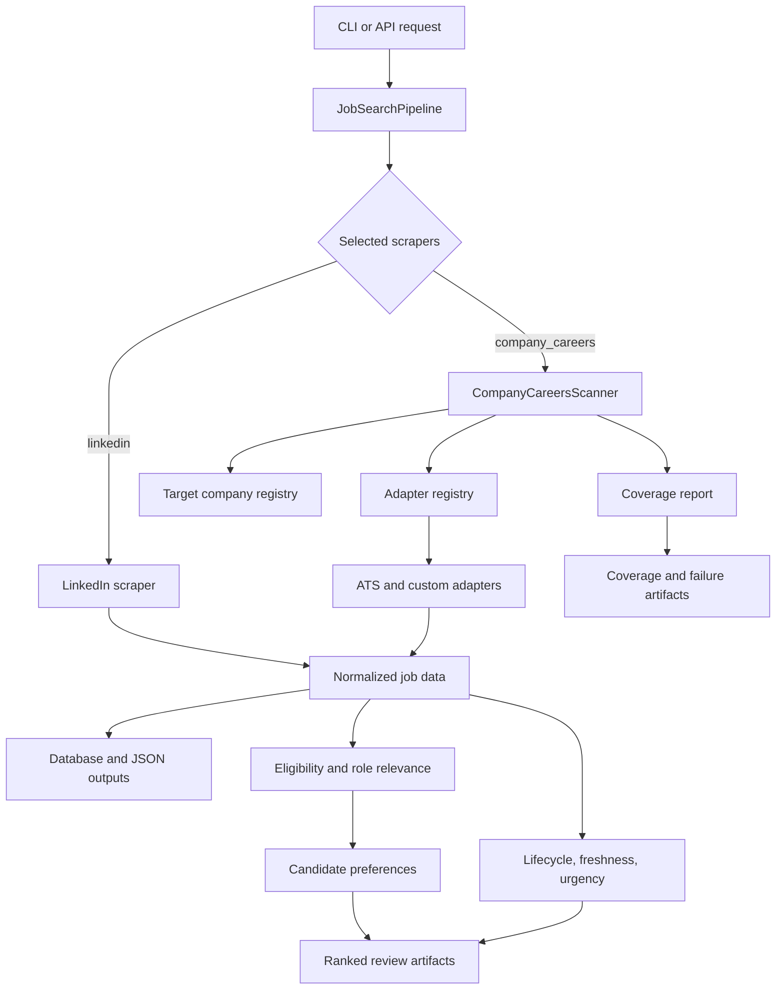

# Architecture

Source enumeration, terminal evidence, registry activation, and lifecycle
absence invariants are documented in [SOURCE_INTEGRITY.md](SOURCE_INTEGRITY.md).

RoleRadar has one orchestration layer and two primary acquisition paths:

- LinkedIn scraping through the existing Playwright scraper
- direct company-careers scanning through reusable ATS and custom adapters

The important product idea is not just fetching jobs. It is fetching jobs while preserving source coverage: what matched, what returned no relevant roles, what failed, and what needs manual follow-up.

## Flow



## Main Modules

`main.py`

CLI entry point. The `search` command accepts `--scrapers linkedin company_careers` so users can choose LinkedIn, direct company-careers scanning, or both.

`src/utils/job_search_pipeline.py`

Shared orchestration layer used by CLI/API flows. It invokes selected scrapers, normalizes results, writes output files, and handles database writes where enabled.

`src/scraper/search/linkedin_scraper/`

Playwright-based LinkedIn scraper inherited from the upstream project and adapted for the current workflow.

`src/scraper/company_careers/`

Direct company-careers scanner package. It loads target companies from YAML, calls the right adapter, filters/ranks relevant jobs, and emits coverage state.

`src/scraper/company_careers/freshness.py`

Config-backed deterministic lifecycle reconciliation. It reuses stable source identity, loads/persists history through the existing Supabase `tracked_jobs` store, advances missing evidence only for successful uncapped scans, parses bounded source dates, and supplies freshness/urgency annotations without changing ranking.

`src/scraper/company_careers/adapters/`

Source-specific adapters. Each adapter converts one source shape into normalized
`JobRecord` objects and reports the observations made while enumerating it.

`config/target_companies.yaml`

Company registry. This is where users add/remove targets and define platform-specific source metadata.

## Adapter Contract

The explicit company-careers flow is:

```text
provider adapter
    -> AdapterResult
       |-- jobs
       |-- scan observations
       |-- item_failures (structural only)
       `-- capabilities_used (descriptive only)
    -> finalize_source_scan
    -> CompanyScanResult
    -> lifecycle / staged persistence
```

`AdapterResult.jobs` contains normalized `JobRecord` objects with:

- `job_id`
- `title`
- `company`
- `location`
- `url`
- `updated_at`
- `source`
- optional `departments`, `offices`, and `description`

`AdapterResult.scan` contains `SourceScanMetadata`: request/page counters,
terminal observations, safety-limit state, source-identity evidence, mutation and
pagination evidence, and adapter diagnostics. These are observations, not a
claim of trust. `finalize_source_scan` remains the only component that decides
whether the evidence is complete, healthy, identity-valid, and authoritative
for absence.

`item_failures` and `capabilities_used` are structural Phase 3 extension points.
Phase 2 does not create partial-success semantics from them. Capabilities are
descriptive only: they cannot create terminal evidence, validate identity, make
a scan authoritative, or bypass central finalization.

Adapters should raise `AdapterError` for parse or endpoint failures that should
be recorded as source failures. Migrated adapters attach their current scan
observations to the same exception instance; exception classes and failure
policy are unchanged.

### Compatibility and diagnostics

Every production dispatcher boundary returns `AdapterResult`. The scanner still
accepts both:

- a legacy `list[JobRecord]`, whose metadata is read from the historical
  `job_radar_scan_metadata` session attribute; and
- an explicit `AdapterResult`, whose `scan` value is used directly while any
  session alias is ignored and cleared.

Raw-list support is retained only as a compatibility path for direct/custom
callers and deterministic injected-adapter tests; no production registry entry
uses it. Existing adapter bodies may still publish the generic diagnostic
session alias, but the exported boundary snapshots it into `AdapterResult`.
Named provider pagination aliases are retained for tests and debugging. Neither
alias class is authoritative after an explicit result is returned, and the
scanner never uses a named provider alias for finalization.

The scanner clears metadata before every invocation and after every explicit
success or failure. Consequently an explicit result cannot inherit evidence
from a prior source, even when a test or caller reuses one session.

Only a centrally finalized `CompanyScanResult` with healthy source state,
validated identity, provider-native terminal evidence, active source state, and
`scan_complete=True` can be authoritative for absence. Request, page, and job
budgets remain safety limits and never terminal evidence. Incomplete and failed
scans retain zero absence authority, so missing-job, possibly-missing, closure,
reopening, and staged Supabase reconciliation behavior is unchanged.

### Final Phase 2 migration status

All 43 canonical dispatcher boundaries now return explicit results. The first
batch covers
Greenhouse, Lever, Ashby, Workday, SmartRecruiters, Eightfold, Dayforce, SAP
SuccessFactors, Teamtailor, BambooHR, Jobvite, Oracle Recruiting, iCIMS/Jibe/
Radancy, static HTML, public JSON, JavaScript embedded data, browser-rendered
HTML, first-party JSON, source XML, and Phenom. The second batch covers Apple,
Avature, Exalead, ClearCompany, Cornerstone CSOD, Deel, BeeSite, StartDate,
TalentBrew, HawkSearch v2, HiBob, UKG Pro, Paycor, PeopleSoft, Amazon, Shopify,
Google, Atlassian, Uber, and IBM Search. The final batch covers ADP, Meta, and
M-Cloud CWS without changing their provider protocols. The registry contains
50 keys because `custom:amazon`, `custom:atlassian`, `custom:google`,
`custom:ibm_search`, `custom:meta`, `custom:shopify`, and `custom:uber` are
aliases of canonical boundaries rather than additional adapters.

The authoritative channel for every migrated boundary is
`AdapterResult.scan`. The boundary bridge still snapshots the generic
`job_radar_scan_metadata` alias inside decorator-migrated adapters, and some
providers retain named pagination aliases for deterministic diagnostics. These
aliases are temporary compatibility surfaces; the scanner ignores them after
receiving an explicit result.

`fetch_with_mutation_restart` returns an explicit `AdapterResult`. It still
reads the generic session alias between the first and optional replacement
traversals for Avature, Atlassian, Eightfold, first-party JSON, iCIMS, Oracle
Recruiting, public JSON, SAP SuccessFactors, SmartRecruiters, and Uber. This is
a restart-internal compatibility detail: replacing it would require changing
the internal traversal callbacks, while retaining it preserves exactly one
restart, discards first-traversal jobs, and keeps all existing mutation
diagnostics. Its caller and the scanner receive explicit observations.

Phase 2 is complete at this boundary. Inventory/hydration, per-item unreadable
semantics, retries, cooldowns, and partial-progress persistence remain Phase 3
work and are not implemented here.

## Coverage States

The company-careers scanner records a status for every configured target:

- `fetched`: source returned at least one matching job
- `fetched_no_matching_roles`: source was reachable, but no jobs matched current search/relevance criteria
- `manual_review_required`: source needs manual follow-up or a future adapter
- `not_implemented`: configured platform has no adapter
- `failed_technical`: source or parser failed technically

This is the main difference between RoleRadar and a simple scraper. Missing results are not all treated the same way.

## Extension Points

Add a new company on an existing platform:

1. Edit `config/target_companies.yaml`.
2. Add the company name and platform-specific fields.
3. Run a company-careers scan.

Add a new source type:

1. Create an adapter under `src/scraper/company_careers/adapters/`.
2. Register it in `src/scraper/company_careers/scanner.py`.
3. Add tests in `tests/test_company_careers.py`.
4. Add one or more companies using that platform in `config/target_companies.yaml`.

Adjust ranking:

1. Edit `src/scraper/company_careers/relevance.py`.
2. Add tests for expected ranking and exclusion behavior.
3. Rerun `tests/test_company_careers.py`.
